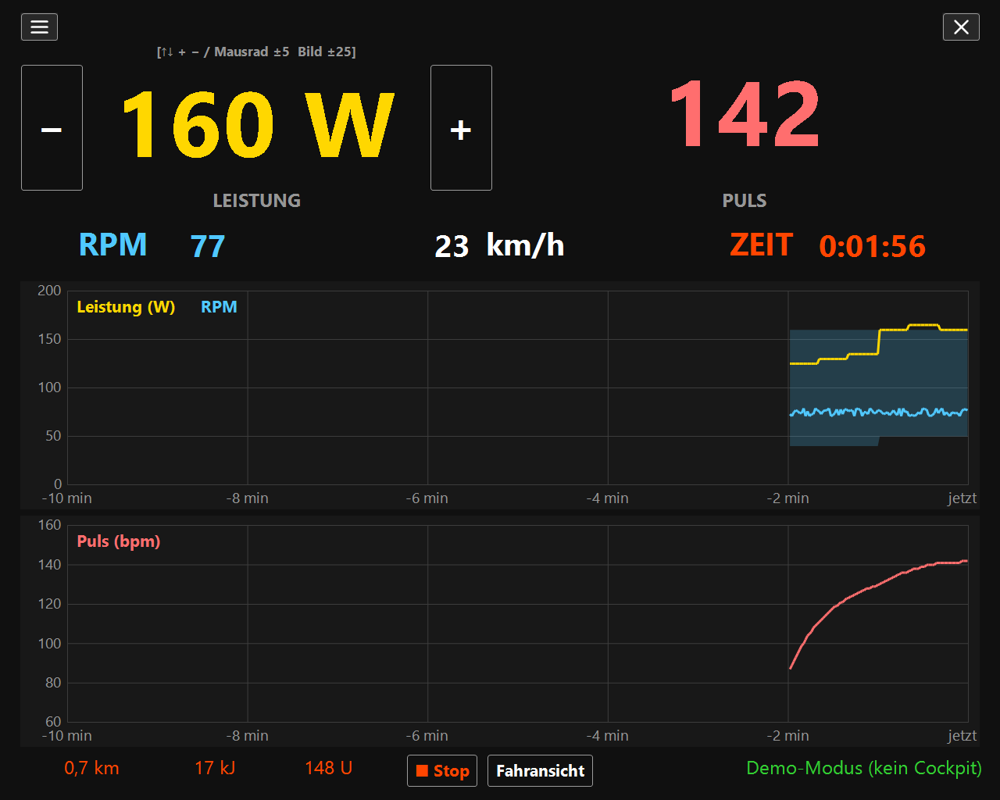
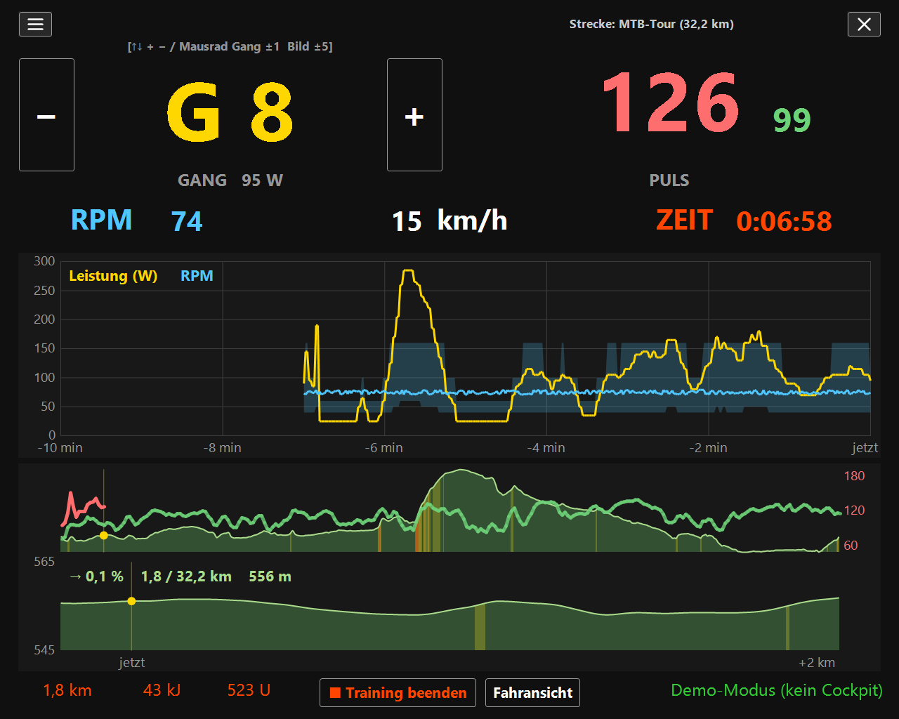
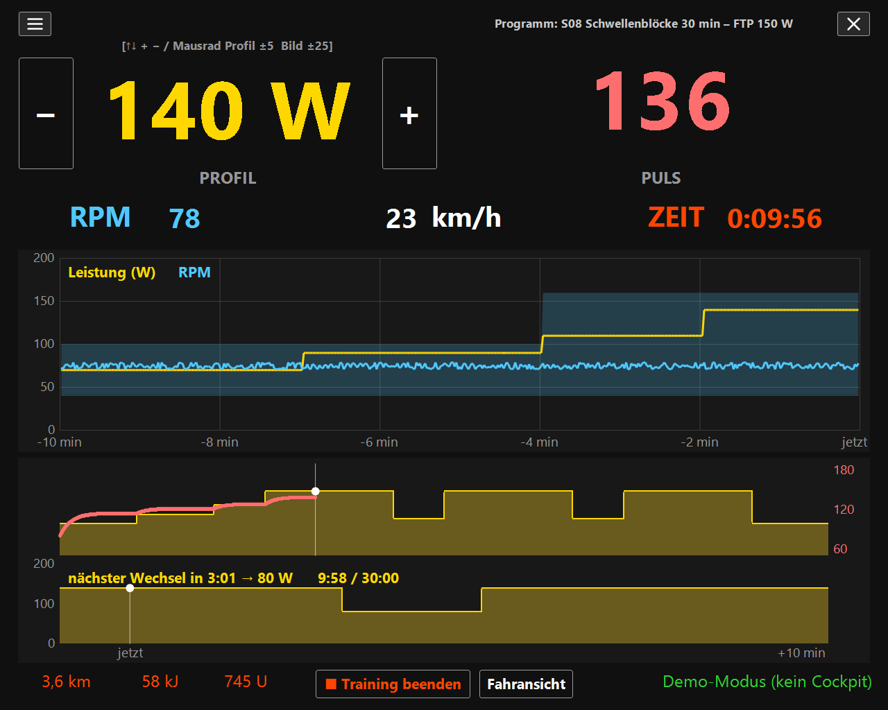
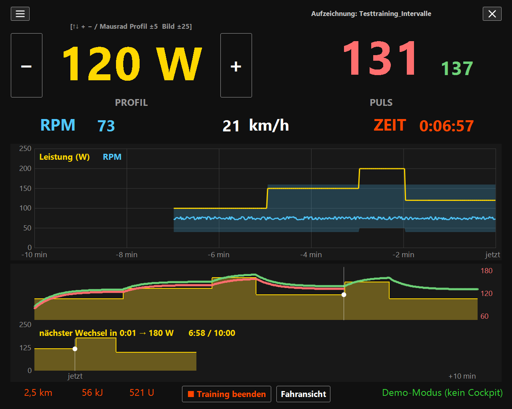

# ErgoWattControl

🇩🇪 Deutsch · 🇬🇧 [English](README.md)

Steuerung für das Daum **ergo_bike 8008 TRS** über die serielle Schnittstelle (RS232, 9600 8N1) – als Ersatz für das Cockpit-Bedienteil und die Originalsoftware ergo_win 2003. Die App spricht **Deutsch und Englisch** (☰ → Einstellungen → Sprache).

📖 **[Hilfe / Bedienungsanleitung](https://andreaskuttruff-git.github.io/ErgoWattControl/Help.de.html)** · [Help (English)](https://andreaskuttruff-git.github.io/ErgoWattControl/Help.en.html) – mit Screenshots; in der App mit F1.

⬇️ **[Download der aktuellen Version](https://github.com/andreaskuttruff-git/ErgoWattControl/releases/latest)** – **Setup** (installiert bei Bedarf die .NET 10 Desktop Runtime mit, dann die App für den angemeldeten Benutzer) oder **ZIP** zum Entpacken (braucht die [.NET 10 Desktop Runtime](https://dotnet.microsoft.com/download/dotnet/10.0)).

## Die Modi

| Freies Training | Strecke fahren (GPX oder FIT) |
|---|---|
|  |  |
| Leistung in 5-W-Schritten vorgeben; oben Leistung und Trittfrequenz, unten der Puls. | Gang statt Watt: Die Bremsleistung folgt aus Steigung, Gewicht und Tempo. Hier eine eigene MTB-Tour als FIT-Datei: im Höhenprofil der Puls von damals (grün) und heute (rot) nach Kilometer, die grüne Zahl neben dem Puls ist der Wert von damals an dieser Stelle. |
| **Trainingsprogramm** | **Aufzeichnung nachfahren** |
|  |  |
| Das Programm gibt die Leistung vor. Oben das ganze Programm mit deinem Puls, darunter die nächsten 10 Minuten mit dem nächsten Wechsel. | Eine frühere Fahrt als Vorgabe: Puls von damals (grün) neben dem von heute (rot), als Kurve und als Zahl neben der Pulsanzeige – so siehst du den Fortschritt. |

## Funktionen

- **Freies Training:** Wattvorgabe in 5-W-Schritten (Tasten ↑↓ + −, Mausrad, Bild ↑↓ ±25 W), Live-Daten von Leistung, RPM, Puls, Geschwindigkeit, Zeit
- **Fahransicht** für einen kleinen Monitor am Rad (1280×1024): Verlaufsgraphen für Leistung/RPM und Puls, erlaubter Drehzahlbereich der Wirbelstrombremse als Band, Pfeile für schneller/langsamer treten
- **Aufzeichnung** als JSON: Art (Training/Strecke/Programm), die Einstellungen beim Start, die Vorgabe (Strecke alle 10 m mit Höhe und Koordinaten bzw. Leistungsverlauf des Programms/Trainings) und eine Zeile Messwerte pro Sekunde. Die Datei wird alle 10 s vollständig neu geschrieben, ein Absturz kostet höchstens diese Sekunden. Ältere CSV-Aufzeichnungen lassen sich weiter nachfahren.
- **Export** (☰ → Aufzeichnung exportieren): FIT für Strava, Garmin Connect, intervals.icu, TrainingPeaks (Strecken als virtuelle Fahrt mit Positionen, sonst Indoor-Training; Garmin FIT SDK) und CSV für Excel; mit Vorschau, Löschen und optionalem Upload in eingebauten Fenstern für Garmin Connect und Strava (selbst anmelden, die App speichert kein Kennwort)
- **Aufzeichnung nachfahren** auch aus FIT-Dateien anderer Geräte und Apps: mit Leistungswerten als Leistungsprofil, sonst als Strecke.
- **Aufzeichnung nachfahren / Trainingsprogramm starten:** Die Startdialoge zeigen die Einstellungen, die für den Lauf wirken, änderbar nur für diesen Lauf („Als Standard speichern“ übernimmt sie in die `settings.json`). Eine Strecken-Aufzeichnung wird wieder als Strecke gefahren (gespeicherte Strecke, simuliert mit den Einstellungen der Aufzeichnung: Gewichte, Übersetzung, Steigungsfaktor, Widerstände, Wattgrenze). Programme und andere Aufzeichnungen folgen dem Leistungsverlauf – dort wirkt nur die Wattgrenze.
- **Strecke fahren:** GPX-Strecke oder FIT-Datei mit GPS und Höhe (z. B. eigene Touren aus Garmin Connect) nachfahren, mit dem Puls von damals (grün) und heute (rot) nach Kilometer im Höhenprofil; aus Steigung, Gewicht und virtueller Geschwindigkeit (Trittfrequenz × Gang) wird die Bremsleistung berechnet. Übersetzung Rennrad oder MTB, Steigungsfaktor einstellbar
- Automatisches Verbinden und Neuverbinden nach einem Cockpit-Reset
- **Trainingsprogramme** (JSON mit Beschreibung und Leistungsprofil), fahrbar über „Trainingsprogramm starten“. Sie sind in die exe eingebettet; beim Start schreibt die App fehlende oder veränderte Dateien nach `Dokumente\ErgoWattControl\Programs` (Änderungen dort werden also überschrieben, eigene Programme mit anderem Namen bleiben erhalten). Der Auswahldialog zeichnet zum markierten Programm den Leistungsverlauf und zeigt die Beschreibung (Details und Quellen in `Programs\README.md`):
  - `P01`–`P44`: die wattgesteuerten Festprogramme des 8008 TRS aus dem Handbuch (1–28, Cool-down 42–44)
  - `S00`–`S08`: Programme nach aktueller Trainingswissenschaft – Rampentest zur FTP-Bestimmung, Grundlage, 4×4, 4×8, 30/15, Unterschwelle, 10×1 min, 3×20 s, Schwellenblöcke 30 min, jeweils für FTP 150/200/250 W
  - Eigene Programme: JSON-Dateien im Ordner `CustomPrograms` (Dokumente\ErgoWattControl bzw. neben der exe), stehen mit ★ oben in der Liste; das Format beschreibt das JSON-Schema [`Schema/TrainingProgram.schema.json`](Schema/TrainingProgram.schema.json), Vorlage [`Example_Custom_Program.json`](Schema/Example_Custom_Program.json)
- **Hilfe** für Fahrer in einem eigenen Fenster (WebView2): F1 öffnet sie beim Abschnitt zur aktuellen Ansicht bzw. zum offenen Dialog, ☰ → Hilfe am Anfang. `Help.de.html`, `Help.en.html` und `HelpPics\` sind in die exe eingebettet (die Seite in der Sprache der App); ohne WebView2-Laufzeit öffnet sich die Hilfe im Browser
- **Sprachen:** Deutsch und Englisch; „Automatisch“ richtet sich nach Windows (ohne deutsches Windows Englisch). Zahlen und Datum folgen den Windows-Einstellungen.
- **Demo-Modus** ohne Ergometer: in den Einstellungen „Gerät: Demo“ oder `ErgoWattControl.exe --demo [strecke.gpx]`
- **Start auf dem Hauptbildschirm** statt auf dem Fahrer-Monitor: `ErgoWattControl.exe -main` (kombinierbar mit `-demo`)

## Aufbau des Quellcodes

| Ordner | Inhalt |
|---|---|
| `Devices/` | Geräteschicht: `IErgometer` (Schnittstelle jedes Ergometers: Zielleistung setzen, Messwerte `ErgometerData`, Status, Fähigkeiten), `ErgoController` (geräteunabhängig: Zielleistung, Wattgrenze, Gerätewechsel), `ErgometerTypes` (Liste der Gerätearten) |
| `Devices/Daum/` | Daum ergo_bike über RS232: Protokoll (`DaumCockpit`), Verbindung/Neuverbinden/Reset (`DaumErgometer`), Drehzahlbereich der Wirbelstrombremse |
| `Devices/Demo/` | Simulierter Fahrer (`DemoErgometer`) |
| `Training/` | `TrainingController`: das laufende Training ohne Fenster – Modus, Aufnahme, Einstellungen für diese Fahrt. Die drei Modi `FreeTraining`, `RouteTraining` und `ReplayTraining` (Aufzeichnung oder Programm) bestimmen Leistung, Wirkung der Tasten, Aufnahmezeilen, Dateiname und Ergebnis |
| `RideView/` | Fahransicht (`RideForm`, zeigt nur an und führt die Dialoge), Verlaufsgraph, Mausrad, Zusammenfassung, Monitorauswahl |
| `Recording/` | Aufzeichnung (`JsonRecorder`, Dateiformat `RecordingFile`), Umbenennen/Verwerfen |
| `Route/` | GPX-Strecke, Simulation (Gänge, Steigung, Leistung), Höhenprofil, Streckenauswahl |
| `Replay/` | Aufzeichnung nachfahren oder Trainingsprogramm starten: Einlesen, Ablauf, Leistungsprofil, Übersicht, Programmauswahl |
| `Localization/` | Mehrsprachigkeit: `Strings.resx` (Englisch, auch für Sprachen ohne Übersetzung) und `Strings.de.resx` (Deutsch), Zugriff über `L.T`/`L.F`; `Language` setzt die Sprache aus der Einstellung beim Start; `LocalizedText` für Texte je Sprache in Programmdateien |
| `Settings/` | `settings.json` (`AppSettings`) mit den Fahrwerten als eigener Gruppe (`RideValues`: Gewichte, Übersetzung, Steigungsfaktor, Widerstände, Wattgrenze – auch pro Fahrt im Startdialog änderbar), Einstellungsdialog |
| `Tests/` | Unittests (xUnit): Vertragstests für jedes Gerät, `ErgoController`, Cockpit-Protokoll und Verbindung gegen ein simuliertes Cockpit, Trainingsmodi, `settings.json`, Aufzeichnungen, FIT/CSV-Export, Programme, Strecken, Texte in beiden Sprachen und Pseudolokalisierung |

## Weitere Geräte anbinden

Die Oberfläche spricht nur mit `ErgoController`, der nur mit `IErgometer`. Für ein neues Gerät (z. B. Bluetooth-Trainer mit FTMS, ANT+ FE-C):

1. Klasse in einem eigenen Ordner unter `Devices/` anlegen, die `IErgometer` implementiert: Verbindung im Hintergrund halten, `SetTargetPower` umsetzen, `DataReceived`/`StatusChanged` auslösen und in `Capabilities` angeben, was das Gerät kann (Maximalleistung, Wattraster, ggf. Drehzahlbereich der Bremse). Werte, die das Gerät nicht misst (Strecke, Energie …), bleiben `null` – die App rechnet sie dann selbst. Den Vertrag, den jedes Gerät einhalten muss (erst `Start` verbindet, Zielleistung auch vor dem Verbinden, nach `Dispose` keine Ereignisse mehr …), beschreibt `IErgometer`.
2. Einen Eintrag `ErgometerType` in `ErgometerTypes.All`: Id für die `settings.json` (danach nie mehr ändern), Schlüssel des Namens in `Localization\Strings*.resx`, Erzeugung, ob es über einen COM-Port verbunden wird und wie „Verbindung testen“ geht. Der Einstellungsdialog richtet sich danach.
3. In `Tests/ErgometerContractTests.cs` eine Unterklasse anlegen – am besten gegen eine Simulation des Protokolls wie `SimulatedCockpit` für Daum. Dann laufen dieselben Vertragstests wie für Daum und Demo.
4. Nur wenn das Gerät andere Verbindungsdaten als einen COM-Port braucht (z. B. eine Bluetooth-Adresse): Feld in `AppSettings` und eine Zeile im Einstellungsdialog ergänzen.

## Bauen

.NET 10, Windows Forms:

```
dotnet publish ErgoWattControl.csproj -c Release -o publish
```

Tests (laufen auch vor jedem Release auf GitHub; ein Fehler stoppt das Release):

```
dotnet test Tests\ErgoWattControl.Tests.csproj
```

**Pseudolokalisierung:** Die Tests bauen jedes Fenster mit künstlich verfremdeten Texten (Akzente, etwa 40 % länger, in `⟦ ⟧`) und prüfen, dass kein Text an den Ressourcen vorbei gesetzt ist, keiner in einem festen Feld abgeschnitten wird und kein Dialog größer als der Monitor am Ergometer (1280 × 1024) wird. Zum Ansehen: `"Language": "pseudo"` in die `settings.json` schreiben.

Sie brauchen kein Ergometer: `SimulatedCockpit` spielt das Daum-Cockpit nach – mit ausbleibenden oder verrutschten Antworten und Resets. Einstellungen und Dateien landen in einem eigenen Temp-Ordner, nie in den echten.

Setup (WiX 5, wird beim Bauen per NuGet geholt): `Setup\build-setup.ps1 [-Version 1.0.0]` veröffentlicht die App, lädt die aktuelle .NET 10 Desktop Runtime von Microsoft (Prüfsumme wird kontrolliert) und baut `Setup\out\ErgoWattControl-Setup.exe`:

- `Setup\Installer`: MSI, pro Benutzer nach `%LocalAppData%\Programs\ErgoWattControl`, Verknüpfung im Startmenü und (abwählbar, `DESKTOPSHORTCUT`) auf dem Desktop
- `Setup\Bundle`: Setup.exe (Burn), installiert die Runtime nur, wenn sie fehlt, dann das MSI. Eigene Oberfläche (`Theme.xml`, Texte in `Theme.en.wxl` und `Theme.de.wxl` – auf deutschem Windows Deutsch, sonst Englisch): Bild der App, Häkchen „Verknüpfung auf dem Desktop“, am Ende „Starten“ mit Wahl Demo-Modus (startet `ErgoWattControl.exe -demo:1` bzw. `-demo:0`). Still: `ErgoWattControl-Setup.exe /passive DesktopShortcut=0`

Ein Versions-Tag (`v1.2.3`) baut beides auf GitHub und legt ein Release mit Setup und ZIP an (`.github/workflows/release.yml`).

## Konfiguration

Datenordner: `settings.json` und das Protokoll `ErgoWattControl.log` in `%AppData%\ErgoWattControl`, Aufzeichnungen, GPX-Strecken und Programme in `Dokumente\ErgoWattControl`. **Portabel:** Liegt eine `settings.json` neben der exe, bleibt alles im Programmordner (so laufen ältere Installationen und ZIP-Kopien unverändert weiter).

`settings.json` (wird beim ersten Start angelegt): Sprache (`Language`: `auto`, `de` oder `en`), Gerät (`Device`: `DaumRs232` oder `Demo`), COM-Port, Ablageordner, Monitor der Fahransicht, die Fahrwerte (`Ride`: Gewichte, Übersetzung, Steigungsfaktor, …) sowie die Dateinamen-Muster der Aufzeichnungen:

| Einstellung | Für | Vorgabe |
|---|---|---|
| `FileNameTraining` | freies Training und nachgefahrene Aufzeichnung | `Training_{Date}_{Time}` |
| `FileNameRoute` | Strecke fahren | `Route_{Route}_{Date}_{Time}` |
| `FileNameProgram` | Trainingsprogramm starten | `Program_{Program}_{Date}_{Time}` |

Platzhalter: `{Date}`, `{Time}`, `{Route}` (GPX-Dateiname), `{Training}` (nachgefahrene Aufzeichnung), `{Program}` (Programmdatei, z. B. `S02_FTP200_Norwegian_4x4`); die deutschen Platzhalter älterer Versionen stellt die App beim Start um. Der Name lässt sich im Startdialog von Strecke, Aufzeichnung und Programm ändern, im freien Training nach „Stop“.

## Lizenz

[MIT](LICENSE) – frei nutzbar, veränderbar und weitergebbar, auch kommerziell, solange der Copyright-Hinweis erhalten bleibt. Ohne Gewähr: Die Benutzung eines Ergometers geschieht auf eigene Gefahr.

Die App nutzt das [Garmin FIT SDK](https://developer.garmin.com/fit/) (unter der FIT Protocol License), [Microsoft WebView2](https://www.nuget.org/packages/Microsoft.Web.WebView2) und `System.IO.Ports`, jeweils unter eigener Lizenz. „Daum“ und „ergo_bike“ sind Namen von Daum Electronic; dieses Projekt steht in keiner Verbindung zu Daum Electronic.
