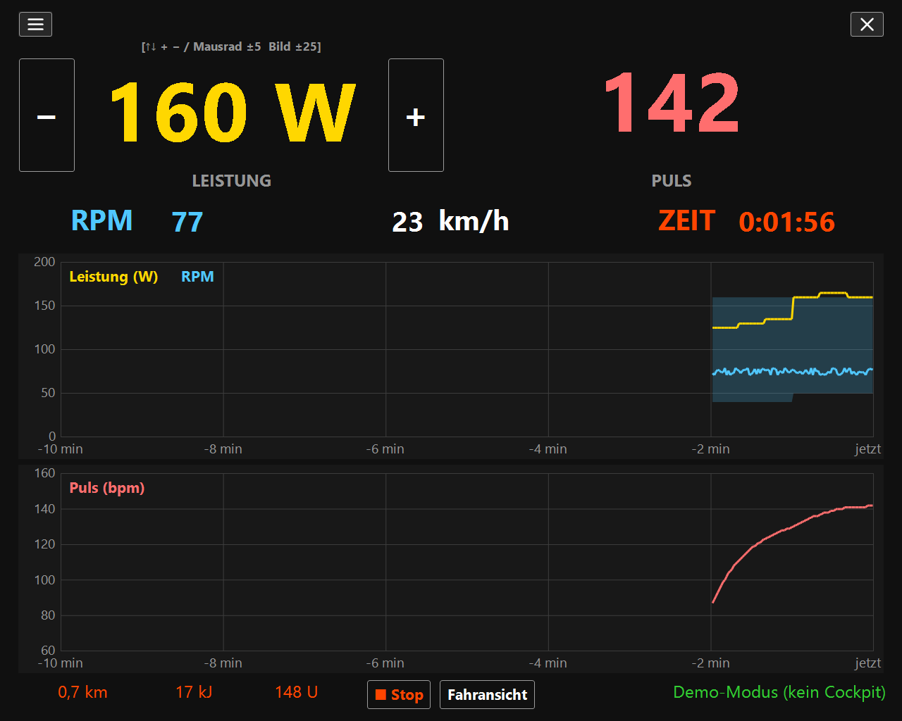
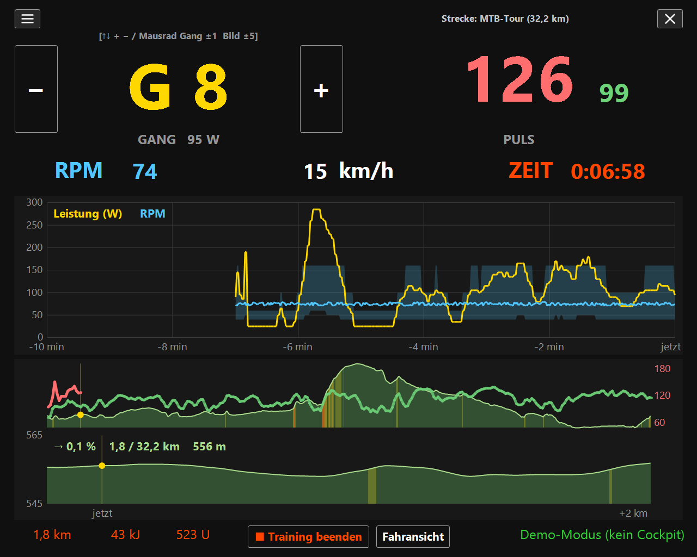
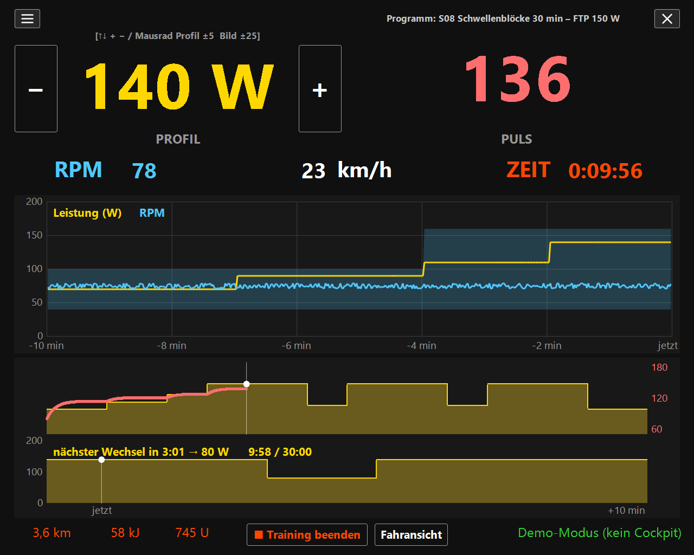
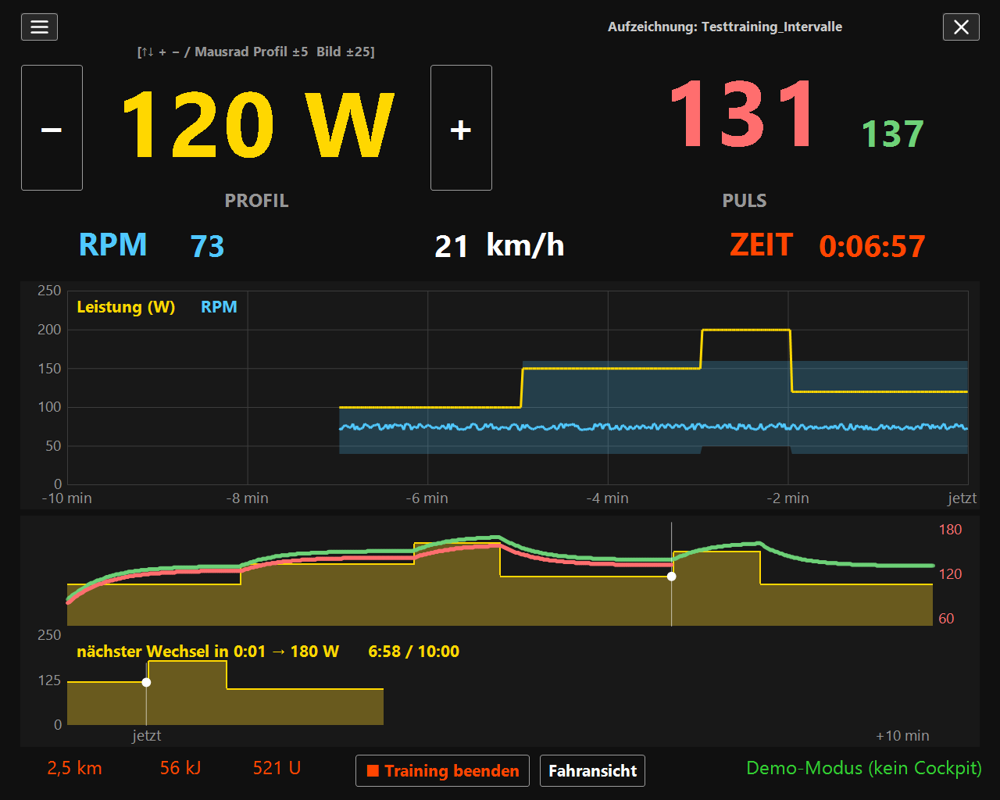

# ErgoWattControl

🇩🇪 [Deutsch](README.md) · 🇬🇧 English

Control for the Daum **ergo_bike 8008 TRS** via the serial port (RS232, 9600 8N1) – as a replacement for the cockpit control unit and the original software ergo_win 2003. The app speaks **English and German** (☰ → Settings → Language).

📖 **[Help / user guide](https://andreaskuttruff-git.github.io/ErgoWattControl/Help.en.html)** · [Hilfe (Deutsch)](https://andreaskuttruff-git.github.io/ErgoWattControl/Help.de.html) – with screenshots; in the app with F1.

⬇️ **[Download the latest version](https://github.com/andreaskuttruff-git/ErgoWattControl/releases/latest)** – **Setup** (installs the .NET 10 Desktop Runtime if needed, then the app for the signed-in user) or **ZIP** to unpack (needs the [.NET 10 Desktop Runtime](https://dotnet.microsoft.com/download/dotnet/10.0)).

## The modes

The screenshots show the app in German; in English the texts are in the same places.

| Free training | Riding a route (GPX or FIT) |
|---|---|
|  |  |
| Set the power in steps of 5 W; at the top power and cadence, below the pulse. | Gear instead of watts: the brake power follows from gradient, weight and speed. Here an own MTB tour as a FIT file: in the elevation profile the pulse back then (green) and today (red) by kilometre, the green number next to the pulse is the value back then at this point. |
| **Training program** | **Replaying a recording** |
|  |  |
| The program sets the power. At the top the whole program with your pulse, below it the next 10 minutes with the next change. | An earlier ride as target: the pulse back then (green) next to today’s (red), as a curve and as a number next to the pulse display – so you see your progress. |

## Features

- **Free training:** target power in steps of 5 W (keys ↑↓ + −, mouse wheel, PgUp/PgDn ±25 W), live data of power, RPM, pulse, speed, time
- **Ride view** for a small monitor on the bike (1280×1024): graphs for power/RPM and pulse, the permitted cadence range of the eddy-current brake as a band, arrows for pedalling faster/slower
- **Recording** as JSON: kind (training/route/program), the settings at the start, the target (route every 10 m with elevation and coordinates, or the power profile of the program/training) and one line of measured values per second. Keys and columns are English in every language. The file is written completely every 10 s, a crash costs at most these seconds. Recordings of version 1.x (German keys) and older CSV recordings can still be replayed.
- **Export** (☰ → Export recordings): FIT for Strava, Garmin Connect, intervals.icu, TrainingPeaks (routes as a virtual ride with positions, otherwise indoor training; Garmin FIT SDK) and CSV for Excel; with preview, delete and optional upload in built-in windows for Garmin Connect and Strava (sign in yourself, the app stores no password)
- **Replaying recordings** also from FIT files of other devices and apps: with power data as a power profile, otherwise as a route.
- **Replaying a recording / starting a training program:** the start dialogs show the settings that apply to the run, changeable for this run only (“Save as default” takes them into `settings.json`). A route recording is ridden as a route again (stored route, simulated with the settings of the recording: weights, gearing, gradient factor, resistances, power limit). Programs and other recordings follow the power profile – only the power limit applies there.
- **Riding a route:** ride a GPX route or a FIT file with GPS and elevation (e.g. your own tours from Garmin Connect), with the pulse back then (green) and today (red) by kilometre in the elevation profile; the brake power is calculated from gradient, weight and virtual speed (cadence × gear). Road bike or MTB gearing, adjustable gradient factor
- Automatic connecting and reconnecting after a cockpit reset; if the recordings folder can’t be written, the ride is still saved in a fallback folder
- **Training programs** (JSON with name, description and power profile, texts per language), ridden via “Start a training program”. They are embedded in the exe; at start the app writes missing or changed files to `Documents\ErgoWattControl\Programs` (so changes there are overwritten, own programs with another name are kept). The selection dialog draws the power profile of the selected program and shows its description (details and sources in `Programs\README.md`):
  - `P01`–`P44`: the power-controlled fixed programs of the 8008 TRS from the manual (1–28, cool-down 42–44)
  - `S00`–`S08`: programs based on current training science – ramp test to find the FTP, endurance base, 4×4, 4×8, 30/15, sub-threshold, 10×1 min, 3×20 s, threshold blocks 30 min, each for an FTP of 150/200/250 W
  - Custom programs: JSON files in the folder `CustomPrograms` (Documents\ErgoWattControl or next to the exe), listed with ★ at the top; the format is described by the JSON schema [`Schema/TrainingProgram.schema.json`](Schema/TrainingProgram.schema.json), template [`Example_Custom_Program.json`](Schema/Example_Custom_Program.json)
- **Help** for riders in a window of its own (WebView2): F1 opens it at the section for the current view or open dialog, ☰ → Help at the beginning. `Help.de.html`, `Help.en.html` and `HelpPics\` are embedded in the exe (the page in the language of the app); without the WebView2 runtime the help opens in the browser
- **Languages:** English and German; “Automatic” follows Windows (English unless Windows is German). Numbers and dates follow the Windows settings.
- **Demo mode** without an ergometer: “Device: Demo” in the settings or `ErgoWattControl.exe --demo [route.gpx]`
- **Start on the main screen** instead of the rider’s monitor: `ErgoWattControl.exe -main` (can be combined with `-demo`)

## Structure of the source code

| Folder | Content |
|---|---|
| `Devices/` | Device layer: `IErgometer` (interface of every ergometer: set the target power, measured values `ErgometerData`, status, capabilities), `ErgoController` (device-independent: target power, power limit, changing device), `ErgometerTypes` (list of device kinds) |
| `Devices/Daum/` | Daum ergo_bike via RS232: protocol (`DaumCockpit`), connecting/reconnecting/reset (`DaumErgometer`), cadence range of the eddy-current brake |
| `Devices/Demo/` | Simulated rider (`DemoErgometer`) |
| `Training/` | `TrainingController`: the running training without a window – mode, recording, settings for this ride. The three modes `FreeTraining`, `RouteTraining` and `ReplayTraining` (recording or program) decide power, effect of the keys, recorded rows, file name and result |
| `RideView/` | Ride view (`RideForm`, only displays and runs the dialogs), graphs, mouse wheel, summary, monitor selection |
| `Recording/` | Recording (`JsonRecorder`, file format `RecordingFile`), export, upload, renaming/discarding |
| `Route/` | GPX route, simulation (gears, gradient, power), elevation profile, route selection |
| `Replay/` | Replaying a recording or starting a training program: reading, run, power profile, overview, program selection |
| `Localization/` | Languages: `Strings.resx` (English, also for languages without a translation) and `Strings.de.resx` (German), accessed via `L.T`/`L.F`; `Language` sets the language from the setting at start; `LocalizedText` for texts per language in program files |
| `Settings/` | `settings.json` (`AppSettings`) with the ride values as a group of their own (`RideValues`: weights, gearing, gradient factor, resistances, power limit – also changeable per ride in the start dialog), settings dialog |
| `Tests/` | Unit tests (xUnit): contract tests for every device, `ErgoController`, cockpit protocol and connection against a simulated cockpit, training modes, `settings.json`, recordings, FIT/CSV export, programs, routes, texts in both languages and pseudo-localization |

## Connecting other devices

The user interface only talks to `ErgoController`, which only talks to `IErgometer`. For a new device (e.g. a Bluetooth trainer with FTMS, ANT+ FE-C):

1. Create a class in a folder of its own under `Devices/` that implements `IErgometer`: keep the connection alive in the background, apply `SetTargetPower`, raise `DataReceived`/`StatusChanged` and state in `Capabilities` what the device can do (maximum power, power steps, possibly the cadence range of the brake). Values the device doesn’t measure (distance, energy …) stay `null` – the app then works them out itself. The contract every device must keep (only `Start` connects, a target power also before connecting, no events after `Dispose` …) is described in `IErgometer`.
2. An entry `ErgometerType` in `ErgometerTypes.All`: id for `settings.json` (never change it afterwards), name key in `Localization\Strings*.resx`, creation, whether it is connected via a COM port and how “Test connection” works. The settings dialog follows it.
3. Add a subclass in `Tests/ErgometerContractTests.cs` – ideally against a simulation of the protocol like `SimulatedCockpit` for Daum. Then the same contract tests run as for Daum and Demo.
4. Only if the device needs connection data other than a COM port (e.g. a Bluetooth address): add a field to `AppSettings` and a row to the settings dialog.

## Building

.NET 10, Windows Forms:

```
dotnet publish ErgoWattControl.csproj -c Release -o publish
```

Tests (also run before every release on GitHub; a failure stops the release):

```
dotnet test Tests\ErgoWattControl.Tests.csproj
```

**Pseudo-localization:** the tests build every window with artificially altered texts (accents, about 40 % longer, between `⟦ ⟧`) and check that no text is set past the resources, none is cut off in a fixed field and no dialog grows larger than the monitor at the ergometer (1280 × 1024). To look at it: write `"Language": "pseudo"` into `settings.json`.

They need no ergometer: `SimulatedCockpit` plays the Daum cockpit – with missing or out-of-step replies and resets. Settings and files go to a temporary folder of their own, never to the real ones.

Setup (WiX 5, fetched via NuGet when building): `Setup\build-setup.ps1 [-Version 1.0.0]` publishes the app, downloads the current .NET 10 Desktop Runtime from Microsoft (the checksum is verified) and builds `Setup\out\ErgoWattControl-Setup.exe`:

- `Setup\Installer`: MSI, per user to `%LocalAppData%\Programs\ErgoWattControl`, shortcut in the Start menu and (optional, `DESKTOPSHORTCUT`) on the desktop
- `Setup\Bundle`: Setup.exe (Burn), installs the runtime only if it is missing, then the MSI. Own user interface (`Theme.xml`, texts in `Theme.en.wxl` and `Theme.de.wxl` – German on a German Windows, English otherwise): picture of the app, tick box “Desktop shortcut”, at the end “Start” with the choice of demo mode (starts `ErgoWattControl.exe -demo:1` or `-demo:0`). Silent: `ErgoWattControl-Setup.exe /passive DesktopShortcut=0`

A version tag (`v1.2.3`) builds both on GitHub and creates a release with setup and ZIP (`.github/workflows/release.yml`).

## Configuration

Data folders: `settings.json` and the log `ErgoWattControl.log` in `%AppData%\ErgoWattControl`, recordings, GPX routes and programs in `Documents\ErgoWattControl`. **Portable:** if a `settings.json` lies next to the exe, everything stays in the program folder (so older installations and ZIP copies keep working unchanged).

`settings.json` (created on the first start): language (`Language`: `auto`, `de` or `en`), device (`Device`: `DaumRs232` or `Demo`), COM port, recordings folder, monitor of the ride view, the ride values (`Ride`: weights, gearing, gradient factor, …) and the file name patterns of the recordings:

| Setting | For | Default |
|---|---|---|
| `FileNameTraining` | free training and replayed recording | `Training_{Date}_{Time}` |
| `FileNameRoute` | riding a route | `Route_{Route}_{Date}_{Time}` |
| `FileNameProgram` | starting a training program | `Program_{Program}_{Date}_{Time}` |

Placeholders: `{Date}`, `{Time}`, `{Route}` (GPX file name), `{Training}` (replayed recording), `{Program}` (program file, e.g. `S02_FTP200_Norwegian_4x4`); the German placeholders of older versions are converted at start. The name can be changed in the start dialog of route, recording and program, and in free training after “Stop”.
